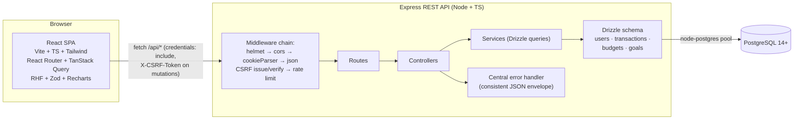
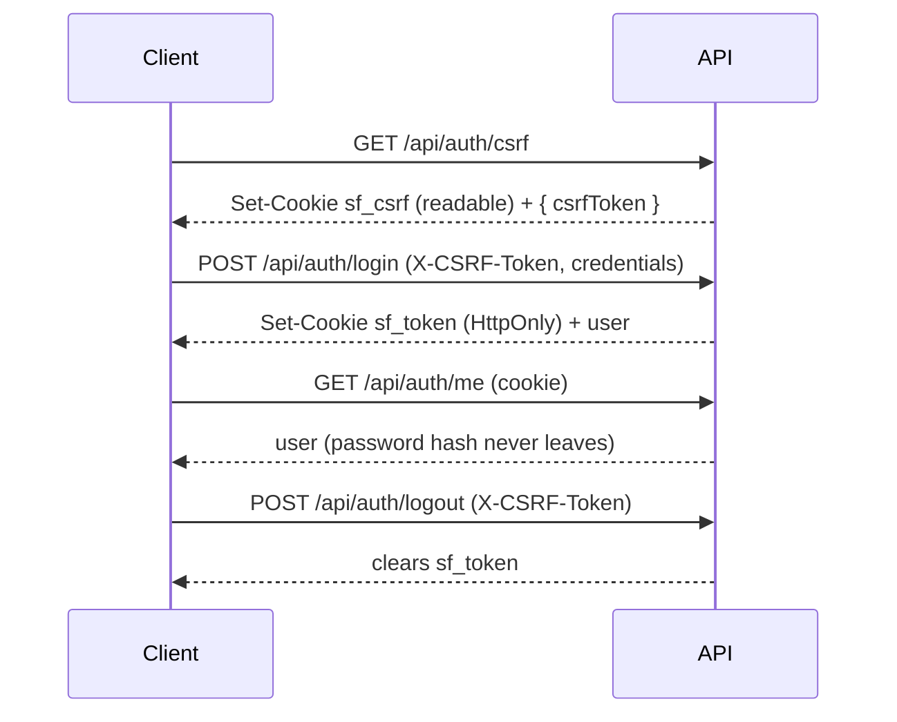

# Smart Finance — Architecture

## System diagram



## Request lifecycle

1. The Vite dev server proxies `/api/*` to `http://localhost:4000`, so the SPA and API are same-origin in development (no CORS preflight, cookies "just work").
2. Every response to a safe request (`GET`) carries a non-HttpOnly `sf_csrf` cookie if one is absent.
3. Every mutating request (`POST/PUT/PATCH/DELETE`) must send header `X-CSRF-Token` matching that cookie (double-submit pattern) or it is rejected `403 CSRF_INVALID`.
4. `POST /api/auth/login` and `/api/auth/register` set the JWT as an HttpOnly, SameSite=Lax cookie (`sf_token`, 7 days, `secure` in production). JavaScript can never read it.
5. `requireAuth` verifies the JWT and attaches `req.user`; `requireAuth` guards all resource routes.
6. Zod schemas validate bodies at the route boundary; services own business rules **and their Drizzle queries**; controllers only translate HTTP ⇄ service results.
7. Any thrown `ApiError` (or unexpected error) reaches the central error handler and leaves as the single error envelope; PostgreSQL error codes (unique violation, invalid uuid) are mapped to deliberate responses there.

## Auth & CSRF flow



## Folder tree

```
Smart Finance/
├── client/                        # Frontend (Vite + React + TS)
│   ├── public/img/                # Downloaded, credited photos (landing)
│   ├── src/
│   │   ├── components/
│   │   │   ├── layout/            # AppLayout (icon rail, mobile bar), Logo
│   │   │   └── ui/                # Button, Input, Card, Skeleton, EmptyState,
│   │   │                          # ErrorState, Pill, Toaster, Ring chart, ZeroLineChart
│   │   ├── features/
│   │   │   ├── auth/              # LoginPage, SignupPage, api, hooks, ProtectedRoute
│   │   │   ├── dashboard/         # DashboardPage + widgets (accounts, plan, spending, bills)
│   │   │   ├── transactions/      # TransactionsPage (+ filters)
│   │   │   ├── budgets/           # BudgetsPage
│   │   │   ├── goals/             # GoalsPage
│   │   │   ├── reports/           # ReportsPage (Recharts)
│   │   │   └── settings/          # SettingsPage (profile PATCH wired)
│   │   ├── landing/               # LandingPage + hero + fragments (quiet-instrument)
│   │   ├── lib/                   # apiClient (CSRF + errors), format, cn
│   │   ├── schemas/               # Zod schemas shared by forms
│   │   ├── types/                 # Domain + API types
│   │   ├── test/                  # RTL setup + tests
│   │   ├── App.tsx                # Router
│   │   ├── main.tsx               # Providers (Query, Router, Toaster)
│   │   └── index.css              # Tailwind v4 @theme tokens from the dealt style
│   └── .env.example
├── server/                        # Backend (Express + TS)
│   ├── drizzle/                   # Generated SQL migrations (committed)
│   ├── src/
│   │   ├── config/                # env (zod-validated)
│   │   ├── controllers/           # auth, users, health, stubs
│   │   ├── db/                    # Drizzle schema, pool/connection, migrate script
│   │   ├── middleware/            # requireAuth, csrf, validate, errorHandler, notFound
│   │   ├── routes/                # index, auth, users, health, {transactions,budgets,goals,reports} stubs
│   │   ├── services/              # auth.service (business rules + queries)
│   │   ├── utils/                 # ApiError, asyncHandler, cookies, jwt, logger
│   │   ├── validation/            # zod schemas (auth, profile)
│   │   ├── app.ts                 # express app factory (testable)
│   │   └── server.ts              # bootstrap, graceful shutdown
│   ├── tests/                     # Vitest + Supertest (health, csrf, auth+Postgres)
│   ├── drizzle.config.ts
│   ├── .env.example
│   └── tsconfig.json
├── docs/                          # PLAN, ARCHITECTURE, DATABASE_SCHEMA, API_CONTRACT, DESIGN
├── .taste-skill/                  # dealt art-direction sheets (Taste Skill working files)
├── .zcode/skills/design-taste-frontend/   # installed Taste Skill
└── README.md
```

## Backend module boundaries

- **routes/** — HTTP surface only; mounts middleware and delegates.
- **controllers/** — translate HTTP ⇄ service calls; no business rules.
- **services/** — business rules and their Drizzle queries (uniqueness checks, credential comparison, profile updates).
- **db/** — the Drizzle schema (tables, enums, indexes, checks), the pg pool, and the migrate script.
- **middleware/** — cross-cutting concerns (auth, CSRF, validation, errors).
- **validation/** — Zod schemas shared by `validate()` middleware.
- **utils/** — `ApiError`, `asyncHandler`, cookie/JWT helpers, logger.

## Frontend conventions

- **Feature-based:** each feature owns its page, components, API calls and hooks.
- **Server state** lives only in TanStack Query (`useMe`, mutations); local UI state uses `useState`.
- **apiClient** is the single fetch wrapper: attaches credentials, ensures CSRF token, normalizes errors into `ApiError { message, code, fieldErrors }`.
- **Types** mirror the API contract in `docs/API_CONTRACT.md`.
